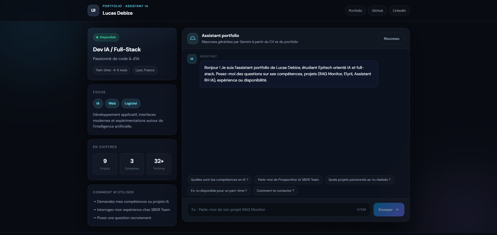
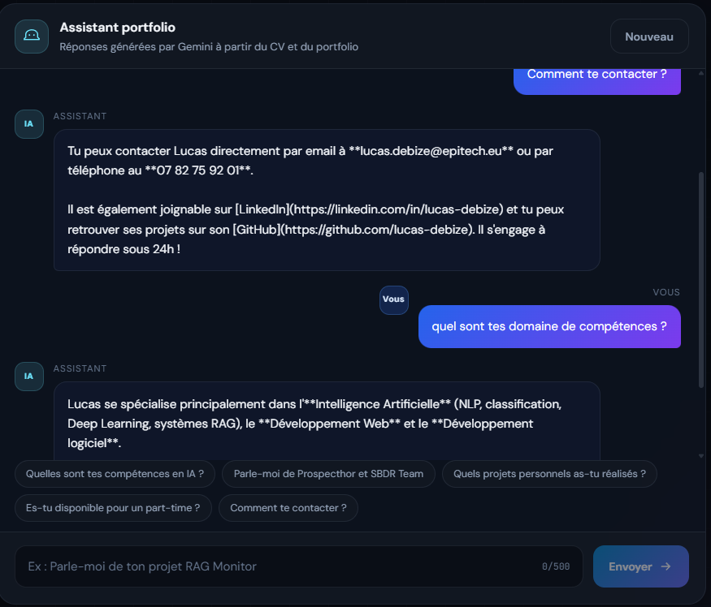

# Chatbot Portfolio IA

Chatbot utilisant React, Express et l'API Google Gemini pour répondre aux questions sur mon profil développeur.

Le backend charge `profile.json` comme base de connaissances et injecte son contenu dans le prompt système Gemini.

## Aperçu

Interface desktop :



Conversation avec l'assistant IA :



## Stack

| Couche   | Technologie             |
| -------- | ----------------------- |
| Frontend | React + Vite            |
| Backend  | Node.js + Express       |
| Données  | profile.json            |
| IA       | Google Gemini           |

## Architecture

```
Utilisateur -> React (5173) -> Express (3001) -> Gemini API -> Réponse
```

## Prérequis

- Node.js 18+
- Clé API Gemini via [Google AI Studio](https://aistudio.google.com/apikey)

## Installation

```bash
cd chatbot/backend
npm install
cp .env.example .env
```

Configurer `.env` :

```env
GEMINI_API_KEY=votre_cle_ici
GEMINI_MODEL=gemini-flash-lite-latest
PORT=3001
```

Les clés récentes Google AI Studio commencent par `AQ.`. Les anciennes clés commencent par `AIza`.

Modèles recommandés (niveau sans frais) : `gemini-flash-lite-latest`, `gemini-3.6-flash`, `gemini-flash-latest`.

Le backend bascule automatiquement sur un modèle de repli si le modèle configuré est indisponible.

```bash
cd ../frontend
npm install
```

Personnaliser le profil dans `backend/profile.json`.

## Lancement

Terminal 1, backend :

```bash
cd chatbot/backend
npm run dev
```

Terminal 2, frontend :

```bash
cd chatbot/frontend
npm run dev
```

Ouvrir [http://localhost:5173](http://localhost:5173).

## API

### POST /api/chat

```json
{ "message": "Quels sont tes projets ?" }
```

Réponse :

```json
{ "reply": "..." }
```

Erreur IA (503) :

```json
{ "error": "...", "code": "AI_QUOTA_EXCEEDED" }
```

### GET /api/health

Vérifie que le serveur fonctionne.

### GET /api/ai-status

Vérifie la configuration de la clé Gemini.

## Structure

```
chatbot/
├── assets/
│   ├── interface-desktop.png
│   └── chat-demo.png
├── backend/
│   ├── server.js
│   ├── profile.json
│   ├── .env.example
│   └── package.json
├── frontend/
│   ├── src/
│   │   ├── App.jsx
│   │   ├── components/Chatbot.jsx
│   │   ├── main.jsx
│   │   └── styles.css
│   └── package.json
└── README.md
```

## Licence

MIT
