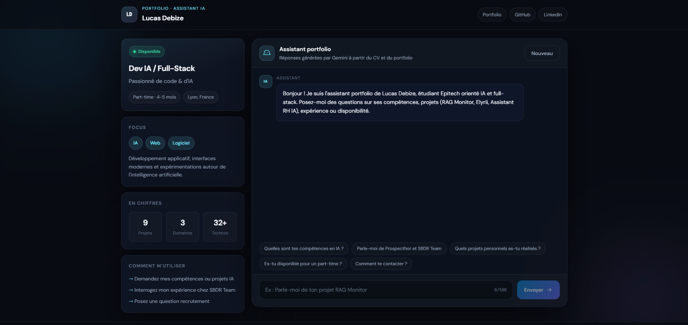
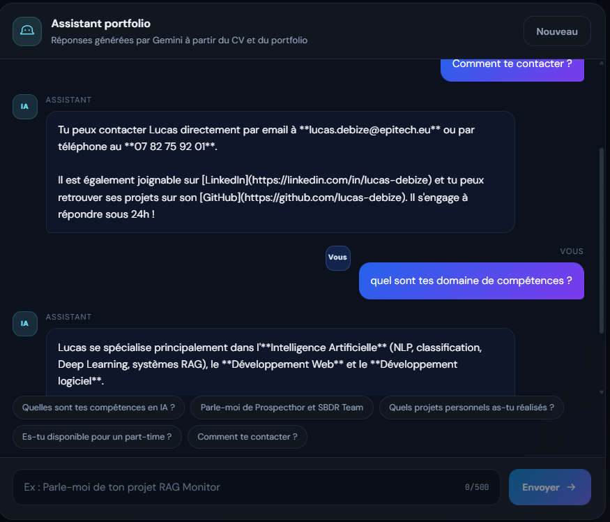
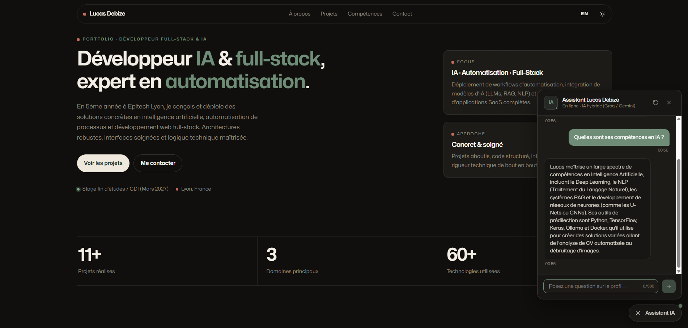

# AI Portfolio Chatbot (Groq & Gemini Fallback)

Intelligent virtual assistant for developer portfolios, built with React, Express, and a hybrid AI engine powered by **Groq (Llama 3.3 70B)** with automatic fallback to **Google Gemini**.

## 🚀 Quick Start

### 1. Live Demo (No installation or API key required)
For those who wish to test the chatbot live on the portfolio:
👉 **[Access the online portfolio](https://lucas-debize.github.io/portfolio/)**  

### 2. Local Testing (Developers & Reviewers)
Run everything with a single command:

```bash
# 1. Clone and configure environment
cp backend/.env.example backend/.env
# Set your GROQ_API_KEY (gsk_...) or GEMINI_API_KEY in backend/.env

# 2. Install all dependencies (root, backend, frontend)
npm run setup

# 3. Launch backend (port 3001) and frontend (port 5173) concurrently
npm run dev
```

Then open [http://localhost:5173](http://localhost:5173).


## 📸 Preview

Desktop interface:



Conversation with AI assistant:



Chatbot on portfolio: 




## 🛠️ Stack & Architecture

| Layer | Technology | Role |
| :--- | :--- | :--- |
| **Frontend** | React 19 + Vite 6 | Responsive chat interface with suggestions & typing indicators |
| **Backend** | Node.js + Express | REST API, AI orchestration, token and rate limit validation |
| **Primary AI Engine** | **Groq (Llama 3.3 70B)** | Ultra-fast inference (~200ms), state-of-the-art open model |
| **Fallback AI Engine** | **Google Gemini** | Automatic fallback on rate limits or API downtime |
| **Profile Data** | `profile.json` + `CV.pdf` | Context dynamically injected into the system prompt |
| **Orchestration** | `concurrently` | Unified process launcher and shutdown in a single terminal |


### Execution & Fallback Flowchart

```
                    ┌─────────────────────────┐
                    │      User / Browser     │
                    └───────────┬─────────────┘
                                │ HTTP / Vite (5173)
                                ▼
                    ┌─────────────────────────┐
                    │   Express Backend (3001)│
                    └───────────┬─────────────┘
                                │
                 ┌──────────────┴──────────────┐
                 ▼ (Primary)                   ▼ (Fallback on 429 / downtime)
       ┌──────────────────┐          ┌──────────────────┐
       │    Groq Cloud    │          │  Google Gemini   │
       │(Llama 3.3 70B /  │          │(Flash Lite /     │
       │  Llama 3.1 8B)   │          │  3.6 Flash)      │
       └──────────────────┘          └──────────────────┘
```


## ⚙️ Configuration (`backend/.env`)

The `backend/.env.example` file outlines all available options:

```env
# Recommended primary engine (Groq - Llama 3.3 70B, ultra-fast)
GROQ_API_KEY=gsk_your_groq_api_key_here
GROQ_MODEL=llama-3.3-70b-versatile

# Fallback engine (Google Gemini)
GEMINI_API_KEY=your_gemini_api_key_here
GEMINI_MODEL=gemini-flash-lite-latest

# Portfolio resume link (Local or Production)
CV_URL=https://lucas-debize.github.io/portfolio/assets/images/CV.pdf

# Optional: path to custom profile file (default: ./profile.json)
PROFILE_PATH=

PORT=3001
```

- **Groq API Key**: Get a free API key at [console.groq.com/keys](https://console.groq.com/keys) (format: `gsk_...`).
- **Gemini API Key**: Get an API key from [Google AI Studio](https://aistudio.google.com/apikey) (format: `AIza...` or `AQ...`).
- You can provide either key, or both to benefit from seamless automatic failover.


## 📁 Project Structure

```
chatbot-portfolio/
├── package.json          # Root orchestrator (setup, dev, build scripts)
├── README.md             # Complete documentation
├── assets/               # Screenshots and illustrations
├── backend/
│   ├── server.js         # Express API, Groq client, Gemini fallback
│   ├── profile.json      # Profile knowledge base & resume links
│   ├── .env.example      # Environment variables template
│   └── package.json
└── frontend/
    ├── index.html
    ├── vite.config.js
    ├── package.json
    └── src/
        ├── main.jsx
        ├── App.jsx
        ├── components/
        │   └── Chatbot.jsx  # Portable and reusable Chatbot component
        └── styles.css
```


## 📜 License

MIT © [Lucas Debize](https://github.com/lucas-debize)
